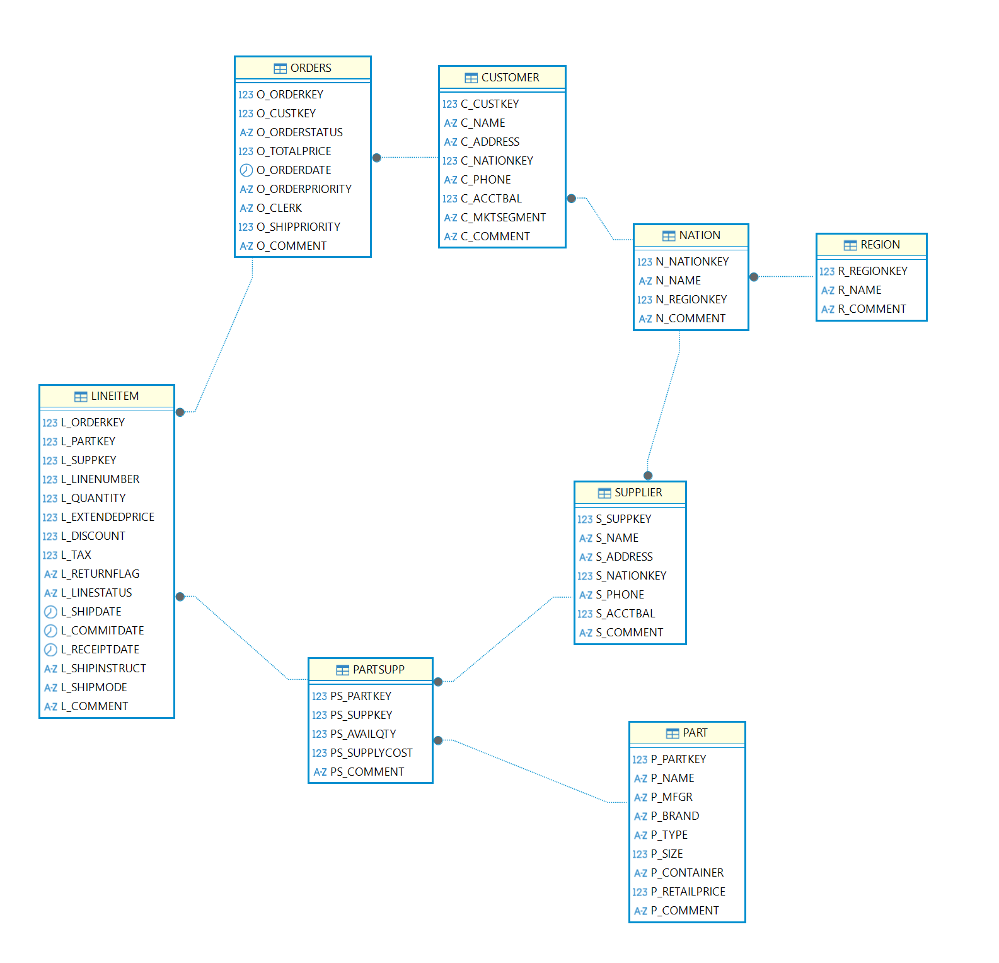
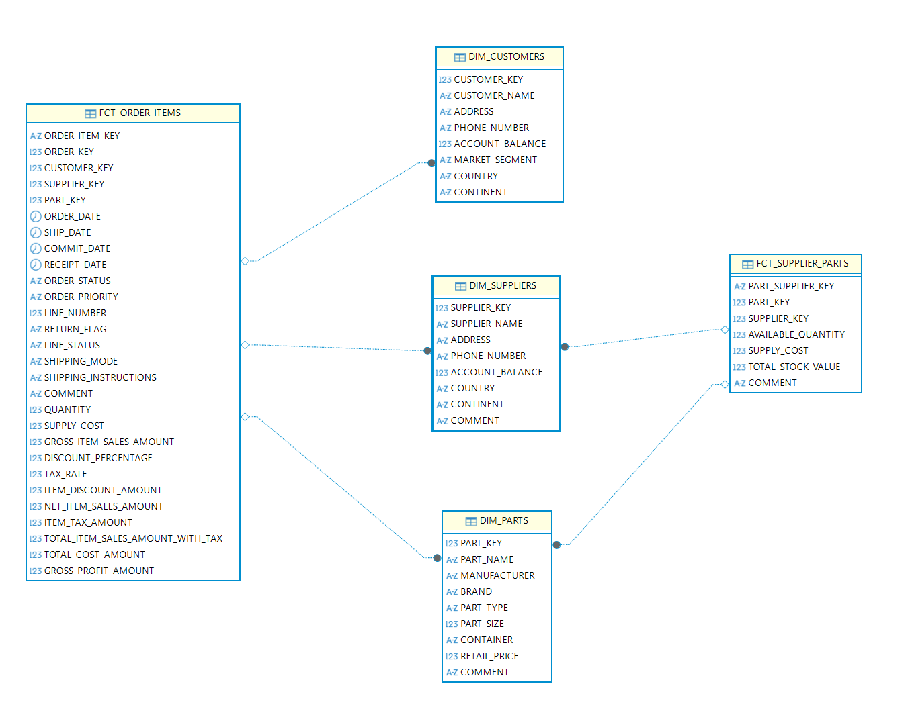

# tpch_analytics — Modélisation dbt du benchmark TPC-H

Projet dbt qui transforme les données brutes **TPC-H** (`SNOWFLAKE_SAMPLE_DATA.TPCH_SF1` sur Snowflake) en un modèle en étoile propre et testé pour l'analyse des ventes, des clients, des pièces et des fournisseurs.

## 1. Source : schéma 3NF TPC-H

Base : `SNOWFLAKE_SAMPLE_DATA` / schéma `TPCH_SF1` — 8 tables normalisées déclarées dans `models/staging/tpch/src_tpch.yml` :

- `customer`, `orders`, `lineitem`
- `part`, `supplier`, `partsupp`
- `nation`, `region`



## 2. Staging : nettoyage et renommage (views)

8 modèles `stg_tpch_*` en `views` (`models/staging/tpch/`) :

- `stg_tpch_customers`, `stg_tpch_orders`, `stg_tpch_line_items`
- `stg_tpch_part`, `stg_tpch_suppliers`, `stg_tpch_partsupp`
- `stg_tpch_nations`, `stg_tpch_regions`

Règles appliquées :
- renommage `c_custkey → customer_key`, `l_orderkey → order_key`, etc.
- clé surrogate `order_item_key = md5(l_orderkey || '-' || l_linenumber)` pour les lignes de commandes
- typage / dates `ship_date`, `commit_date`, `receipt_date` conservées
- tests : `unique`, `not_null`, `accepted_values` (`return_flag`, `line_status`, `order_status`)

## 3. Marts : modèle en étoile (tables)

5 modèles `table` dans `models/marts/` :

- `dim_customers` : client + `country` (nation) + `continent` (region)
- `dim_suppliers` : fournisseur + `country` + `continent`
- `dim_parts` : pièce (prix détail, marque, type, conteneur…)
- `fct_order_items` : grain ligne de commande, joint `line_items + orders + partsupp`
  - montants : `gross_item_sales_amount`, `item_discount_amount`, `net_item_sales_amount`, `item_tax_amount`, `total_item_sales_amount_with_tax`
  - marge : `total_cost_amount` (quantité × `supply_cost`), `gross_profit_amount`
- `fct_supplier_parts` : disponibilité fournisseur, `total_stock_value = available_quantity * supply_cost`

Contraintes référentielles testées dans `models/marts/schema.yml` (`relationships` vers les dims, `accepted_values` pour `line_status`).



## 4. Structure du repo

```
tpch_analytics/
  dbt_project.yml      # staging=view, marts=table
  packages.yml         # dbt_utils, codegen
  models/
    staging/tpch/      # sources + staging (8 vues)
    marts/             # 3 dims + 2 facts (tables)
  macros/
  docs/images/         # schémas 3NF et étoile
```

## 5. Lancer le projet

Prérequis : profil `tpch_analytics` dans `~/.dbt/profiles.yml` pointant sur Snowflake (accès `SNOWFLAKE_SAMPLE_DATA`).

```bash
dbt deps
dbt build
dbt test
dbt docs generate && dbt docs serve
```

## 6. Packages

- `dbt-labs/dbt_utils >=1.3.0`
- `dbt-labs/codegen 0.13.0`
