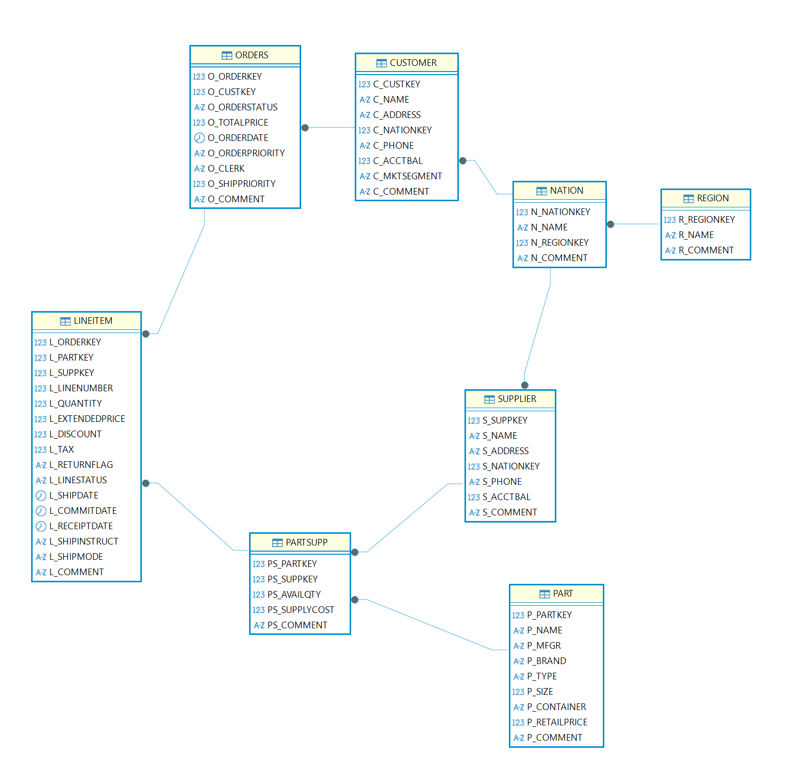
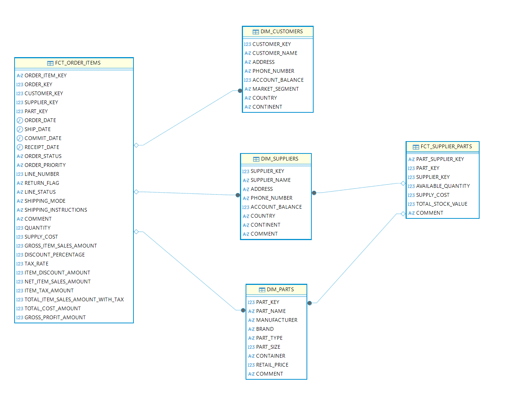

# tpch_analytics — Modélisation dbt du benchmark TPC-H

Projet dbt qui transforme les données brutes **TPC-H** (`SNOWFLAKE_SAMPLE_DATA.TPCH_SF1` sur Snowflake) en un modèle en étoile propre et testé pour l'analyse des ventes, des clients, des pièces et des fournisseurs.

## 1. Source : schéma 3NF TPC-H

Base : `SNOWFLAKE_SAMPLE_DATA` / schéma `TPCH_SF1` — 8 tables normalisées déclarées dans `models/staging/tpch/src_tpch.yml` :

- `customer`, `orders`, `lineitem`
- `part`, `supplier`, `partsupp`
- `nation`, `region`



## 2. Staging : nettoyage et renommage (views)

8 modèles `stg_tpch_*` en `views` (`models/staging/tpch/`) :

- `stg_tpch_customers`, `stg_tpch_orders`, `stg_tpch_line_items`
- `stg_tpch_part`, `stg_tpch_suppliers`, `stg_tpch_partsupp`
- `stg_tpch_nations`, `stg_tpch_regions`

Règles appliquées :
- renommage `c_custkey → customer_key`, `l_orderkey → order_key`, etc.
- clé surrogate `order_item_key` et `part_supplier_key` via `dbt_utils.generate_surrogate_key()`
- typage / dates `ship_date`, `commit_date`, `receipt_date` conservées
- tests : `unique`, `not_null`, `accepted_values` (`return_flag`, `line_status`, `order_status`)

## 3. Intermediate : logique de calcul métier (views)

`models/intermediate/` — une couche entre le staging et les marts, qui isole la logique de calcul
et la rend testable indépendamment du modèle publié.

- `int_order_items_calculated` : grain ligne de commande. Porte les jointures
  (`line_items` ⟶ `orders` ⟶ `partsupp`) et l'intégralité des calculs :
  - montants : `item_discount_amount`, `net_item_sales_amount`, `item_tax_amount`, `total_item_sales_amount_with_tax`
  - coûts et marge : `total_cost_amount` (quantité × `supply_cost`), `gross_profit_amount`
  - attributs dérivés : `delivery_delay_days`, `is_returned`, `gross_margin_percentage`

Les calculs sont vérifiés par 11 tests `dbt_utils.expression_is_true` (identité exacte des formules
+ règles de gestion avec tolérance de 0.02 sur les arrondis), un `equal_rowcount` contre
`stg_tpch_line_items` (grain préservé) et un `unique` sur `order_item_key` (absence de fan-out).

## 4. Marts : modèle en étoile (tables)

6 modèles `table` dans `models/marts/`. **Deux processus métier → deux tables de faits**,
qui partagent les mêmes **dimensions conformes** (`dim_parts`, `dim_suppliers`) :

| Processus métier | Table de faits | Grain |
|---|---|---|
| Vente client | `fct_order_items` | une ligne d'article commandée |
| Approvisionnement / catalogue fournisseur | `fct_supplier_parts` | un couple pièce x fournisseur |

Dimensions :

- `dim_customers` : client + `country` (nation) + `continent` (region)
- `dim_suppliers` : fournisseur + `country` + `continent`
- `dim_parts` : pièce (prix détail, marque, type, conteneur…)
- `dim_date` : dimension des dates (un jour calendaire), générée à partir de la plage
  `dim_date_start_date` / `dim_date_end_date` définie dans `dbt_project.yml`

Le partage de `dim_parts` et `dim_suppliers` entre les deux faits est ce qui permet à un
outil de BI de croiser dans un même tableau de bord le chiffre d'affaires vendu
(`fct_order_items`) et le niveau de stock (`fct_supplier_parts`).

`fct_order_items` référence `dim_date` **4 fois** (dimension à rôle multiple) :
`order_date_key`, `ship_date_key`, `commit_date_key`, `receipt_date_key`.

`fct_supplier_parts` ne porte pas de dimension temporelle : il décrit l'**état courant**
du catalogue fournisseurs, pas un historique d'événements.

Les colonnes `comment` de la source ne sont pas publiées dans les marts : elles restent
au niveau staging, où la source est représentée fidèlement.

Contraintes référentielles testées dans les YAML des marts (`relationships` vers les dims et vers `dim_date`,
`accepted_values` pour `line_status`), volumétrie des dimensions contrôlée par `dbt_utils.equal_rowcount`.



## 5. Structure du repo

```
tpch_analytics/
  dbt_project.yml      # staging=view, intermediate=view, marts=table (+ schema par couche)
  packages.yml         # dbt_utils 1.4.1, codegen 0.13.0 (versions épinglées)
  models/
    staging/tpch/      # sources + staging (8 vues)      -> DBT_DEV_STAGING
    intermediate/      # logique de calcul métier        -> DBT_DEV_INTERMEDIATE
    marts/             # 4 dims + 2 faits (tables)       -> DBT_DEV_MARTS
  macros/dev/          # macros de développement (masquées de la doc dbt)
  .github/workflows/   # CI : dbt build sur PR et push
  docs/images/         # schémas 3NF et étoile
```

Chaque modèle a son fichier YAML de même nom (`stg_tpch_orders.sql` + `stg_tpch_orders.yml`),
conformément à la convention dbt Labs. Seul `src_tpch.yml` regroupe les 8 sources,
qui forment une unité logique (le système source TPC-H).

## 6. Lancer le projet

Prérequis : profil `tpch_analytics` dans `~/.dbt/profiles.yml` pointant sur Snowflake (accès `SNOWFLAKE_SAMPLE_DATA`).

```bash
dbt deps
dbt build
dbt test
dbt docs generate && dbt docs serve
```

## 7. Packages

- `dbt-labs/dbt_utils` **1.4.1** (épinglé)
- `dbt-labs/codegen` **0.13.0** (épinglé)

## 8. Intégration continue

`.github/workflows/dbt-ci.yml` déclenche un `dbt build` (modèles **+** 132 tests) sur chaque PR
et chaque push sur `main`.

Secrets GitHub requis (Settings → Secrets and variables → Actions) :

| Secret | Contenu |
|---|---|
| `SNOWFLAKE_ACCOUNT` | ex. `XYOTBYJ-DD65255` |
| `SNOWFLAKE_USER` | utilisateur technique du CI |
| `SNOWFLAKE_ROLE` | rôle du CI (création de schémas requise) |
| `SNOWFLAKE_WAREHOUSE` | warehouse du CI |
| `SNOWFLAKE_DATABASE` | base du CI |
| `SNOWFLAKE_PRIVATE_KEY` | clé privée PEM (authentification key-pair) |
| `SNOWFLAKE_PRIVATE_KEY_PASSPHRASE` | passphrase de la clé, si elle en a une |

La CI utilise une cible `ci` avec le schema `DBT_CI` → les objets sont créés dans
`DBT_CI_STAGING`, `DBT_CI_INTERMEDIATE` et `DBT_CI_MARTS`, **isolés des environments de dev et de prod**.
